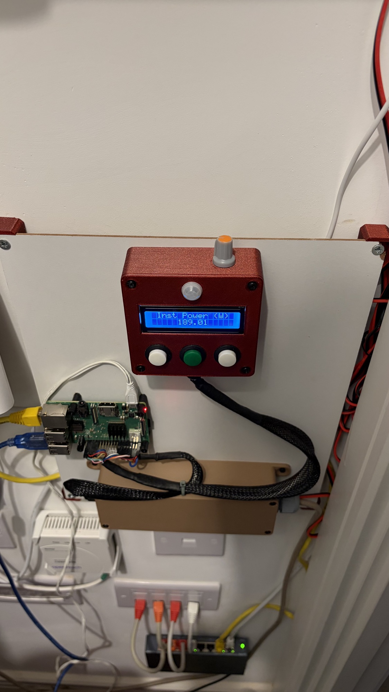

# Home Power Monitor Hardware

[](https://github.com/ScottGibb/Home-Power-Monitor-Hardware/actions/workflows/mega-linter.yaml)
[](https://github.com/ScottGibb/Home-Power-Monitor-Hardware/actions/workflows/kicad.yaml)
[](https://github.com/ScottGibb/Home-Power-Monitor-Hardware/actions/workflows/release-please.yaml)

<!-- markdownlint-disable MD033 -->
<div align="center">
    
</div>
<!-- markdownlint-enable MD033 -->



## Summary

This repository contains the KiCad hardware designs for the [Home Power Monitor project](https://github.com/ScottGibb/Home-Power-Monitor). It currently consists of two hardware components:

- An LCD Control Unit
- An Isolated Conversion Board between the Host Processor and the JSY-MK-194 Power Sensor

For more details on the prototype build, see the [prototyping notes](./docs/PROTOTYPING.md).

## Components

### LCD Control Unit

The `lcd_control_unit` project is the control board for the display section of the power monitor. The schematic is built around a `WC1602A` 16x2 character LCD and is designed as a board for the display assembly. The unit contains the screen along with four button inputs, one of which is connected to a PIR sensor, specifically the AM312 Mini PIR Sensor.

### Power Monitor Protection

The `power_monitor_protection` project is the interface and protection board. It includes isolation circuitry for both serial communication and power.

### External Libraries

The [`./libraries/`](./libraries/) directory contains the external footprints and symbols used by the project.

## Working With the Designs

Open either KiCad project directly in KiCad:

- `./lcd_control_unit/lcd_control_unit.kicad_pro`
- `./power_monitor_protection/power_monitor_protection.kicad_pro`

The custom library content used by the protection board is stored in [`./libraries/`](./libraries/).

## Wiring Harnesses

The [wiring documentation](./wiring/README.md) contains WireViz sources for LCD,
front-panel and protection-board connections. Connector mapping follows the
saved KiCad schematics, host configuration, build photos and confirmed
termination types. See its unresolved details before constructing a harness.

## WireViz Development Tools

The locked Nix flake provides WireViz, Graphviz and DejaVu fonts on macOS and
Linux (Apple Silicon/ARM64 and x86-64):

```sh
nix develop
wireviz --version
dot -V
```

For a one-off render, use `nix run . -- <WireViz arguments>`. Open VS Code from
inside `nix develop` so the recommended WireViz Preview extension inherits the
tools; press F8 to preview a harness and save YAML to refresh it.

## Automation

GitHub Actions are configured to help keep the hardware projects consistent:

- **KiCad** runs project automation and publishes generated artifacts such as schematics, ERC reports, and BOM outputs.
- **MegaLinter** checks repository quality and formatting.
- **WireViz** renders every harness on pushes and pull requests. Wiring has its
  own release PR, changelog and `wiring-v<version>` tag; its exact tagged sources,
  README, HTML/PNG/SVG diagrams and TSV BOMs are attached as `wiring.zip`.
- **Release Please** creates separate releases for each board and attaches its
  generated KiCad files.
- **Dependabot Auto Merge** keeps GitHub Actions and dependency updates moving automatically.

## 3D Printed Cases and Printed Circuit Boards

Due to funding, PCB layouts were never produced for these schematics. This was largely because the boards themselves were too simple to justify manufacturing, so veroboard was used instead. 3D-printed cases and a mounting panel were produced, however, and can be found on Printables and Thingiverse.

| Model                             | Printables                                             | Thingiverse                                              |
| --------------------------------- | ------------------------------------------------------ | -------------------------------------------------------- |
| LCD Control Unit                  | [Printables](https://www.printables.com/model/1886187) | [Thingiverse](https://www.thingiverse.com/thing:7425308) |
| Power Monitor Isolator Box        | [Printables](https://www.printables.com/model/1885924) | [Thingiverse](https://www.thingiverse.com/thing:7425222) |
| Home Power Monitor Mounting Panel | [Printables](https://www.printables.com/model/1888065) | [Thingiverse](https://www.thingiverse.com/thing:7426240) |

## Useful Links

- [Home Power Monitor Software Repository](https://github.com/ScottGibb/Home-Power-Monitor)
- [KiCad](https://www.kicad.org/)
- [AM312 PIR Sensor](https://www.amazon.co.uk/Sensor-Motion-Outdoor-Pyroelectric-Infrared/dp/B0BY7QQ3LX)
- [WC1602A 16x2 LCD Screen](https://www.amazon.co.uk/sourcing-map-Display-Backlight-Interface/dp/B0DSFR7GZ1/ref=sr_1_5?crid=2GEE32FK7YLKS&dib=eyJ2IjoiMSJ9.6cgkXtVrs6QO7KbueDc_Q8g0wwjGAx1K2kBlkmHrGFi8Kd_AFckG5ZycEwGkVj2SLrNkDCulMN-G-dL5X74VrZLTHdHZDzEbV5wcqyKqUMZO2Zr5YGzEVQDsA0WOYL3Y7Szm3EbprEXihGhl4wFlvAuli3Y8uTzu-LmMYMDLA_UdxEwpj0ElsTbmSOXjVih9xeBGH-hmMJ8Pfgmn8J9tIAwTcnetifRADzOj0RYeWnhawOmFOoskjKLDViepO9cMkFbmNIO2q3pi-5HwaywWaXMeANJSD0mSaAf9_EeDoW4.8zvibMO9_k4edjQzDyliyUygZYEio5CPIBom889MZG0&dib_tag=se&keywords=16x02%2Blcd%2Bscreen&qid=1783540433&sprefix=16x02%2Blcd%2Bscreen%2Caps%2C111&sr=8-5&th=1)
- [Buttons](https://www.amazon.co.uk/dp/B07QL1BC23?ref_=ppx_hzsearch_conn_dt_b_fed_asin_title_4)
- [5V-3.3V Isolated Power Supply](https://www.aliexpress.com/item/1005004175798333.html?spm=a2g0o.order_list.order_list_main.5.22eb1802wMyzEk)
- [JSY-MK-194G Power Monitor](https://www.aliexpress.com/item/1005007369940517.html?spm=a2g0o.order_list.order_list_main.30.22eb1802wMyzEk)
