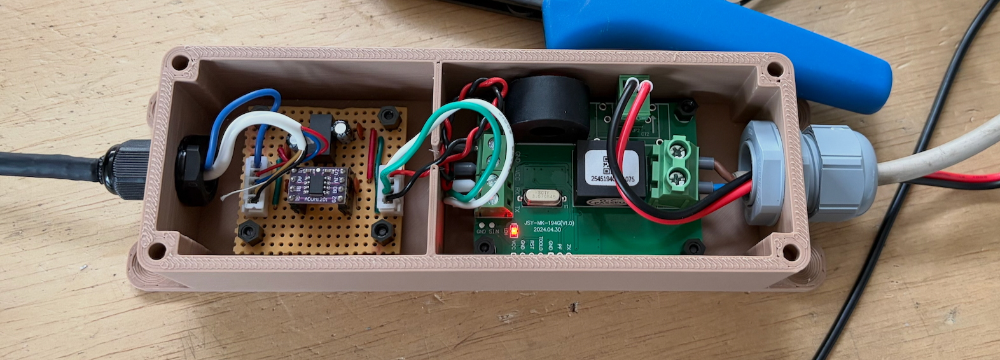
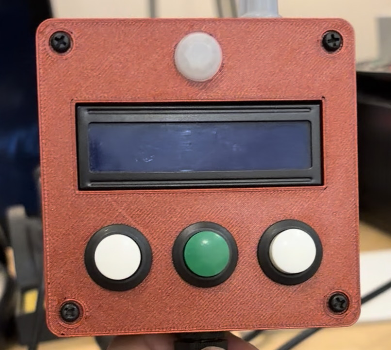
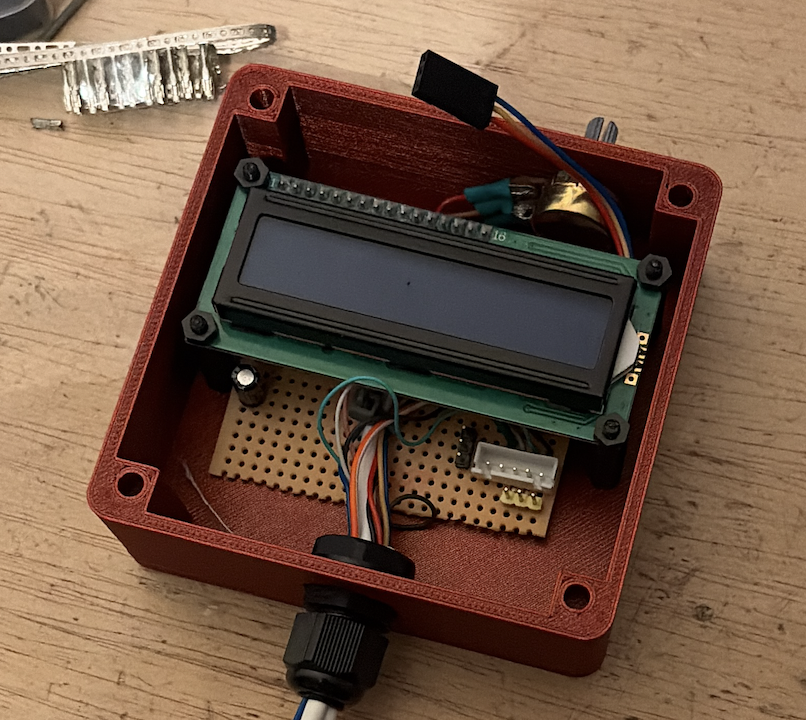

# Prototyping

## Summary

This document contains notes from the prototype stage, along with a few photos of the hardware.

## Isolation Circuitry

Below is a photo of the isolation circuitry used for the project. This was built on veroboard and mounted with thick plastic to reduce any chance of accidental contact with mains wiring. The thickness, double isolation, and locking cable glands may be considered overkill, but when working with mains voltage, every precaution is worth taking.

## LCD Unit Circuitry

Below are a few photos of the initial LCD unit print:

